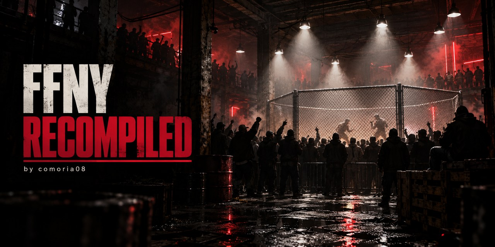

<p align="center"></p>

# Def Jam: Fight for NY — static recompilation

A static recompilation of **Def Jam: Fight for NY** (Xbox, USA version) into a native Windows program. The game's code is translated to C, then compiled on your PC from your own disc image.

> **No game content is provided.** This repository and its releases contain neither the game's code nor its data. The installer reads your disc image, checks it, extracts it and rebuilds everything on your machine. Only use the disc image of a game you own.

## Requirements

- Windows 10 or 11, 64-bit, and a DirectX 11 graphics card.
- The Xbox disc image (`.iso`) of Def Jam: Fight for NY, **USA version**. The installer checks it: the European version and any other one are refused.
- About 4 GB of free space.
- An Xbox-style controller (XInput). The keyboard does not drive the game.

## Installing

### 1. With DJFFNY.exe: the easiest way

Download **`DJFFNY.exe`** from the latest [release](../../releases/latest) and run it. It does everything, in a single window:

- **installation**: folder, build (Clang, all included, or MSVC + DLSS), disc image check, then download of the chosen package, extraction, translation to C and build, with progress and a live log;
- **game settings**: resolution, 4:3 or 16:9, DLSS, filtering, HD texture pack, unlock everything, controller layout;
- **mods**: install a `.mod` file (a zip with a `mod.ini`), one at a time, removable;
- **the game**: the Play button;
- **updates**: the launcher updates itself, and a game update only downloads and rebuilds what changed — no disc image needed, no new extraction, and the translation to C is skipped when its inputs did not change.

It speaks English, French, Spanish, German and Portuguese, following Windows' language (or the one picked in Settings). It installs itself next to the game with a desktop shortcut. It uses WebView2, already part of Windows 10 and 11.

### 2. With a release package, by hand

Each release has two packages. Pick one from [Releases](../../releases), unzip it, double-click **`Installer.bat`** and choose your disc image. Extraction, translation to C and the build take a few minutes.

| Package | Compiler | DLSS | To install on the PC |
|---|---|---|---|
| **MSVC + DLSS** (light, ~2 MB) | Visual Studio | Yes, with an NVIDIA RTX card | Visual Studio Build Tools (C++), Python 3 with `capstone`, CMake. If any is missing, the installer offers to install it with winget, only if you agree. |
| **Built-in Clang** (complete, ~100 MB) | Clang (llvm-mingw), included | No | Nothing: Clang, Python, capstone and CMake are in the `outils` folder. |

**DLSS**: with the MSVC package and an NVIDIA RTX card, the installer offers to download NVIDIA Streamline 2.14.1 (276 MB) from [its official repository](https://github.com/NVIDIA-RTX/Streamline/releases/tag/v2.14.1). It checks the archive's fingerprint before using it. NVIDIA's licence forbids distributing this SDK separately, which is why it is not included in the release.

### 3. From source: rebuild the installer yourself

The port needs the [xboxrecomp](https://github.com/comoria08/xboxrecomp/tree/defjam-bringup) toolkit, a fork of [sp00nznet/xboxrecomp](https://github.com/sp00nznet/xboxrecomp) that carries the port's fixes. Clone both repositories **side by side**:

```
git clone https://github.com/comoria08/defjam_recomp.git
git clone -b defjam-bringup https://github.com/comoria08/xboxrecomp.git
```

Then double-click `defjam_recomp\installer.bat`, or run in PowerShell:

```
.\defjam_recomp\installeur\installer.ps1 -Iso "C:\path\to\DefJam.iso"
```

| Option | Effect |
|---|---|
| `-Iso <path>` | the disc image (otherwise a window asks for it) |
| `-Yes` | installs the missing tools and DLSS without asking |
| `-NoDLSS` | builds without DLSS, without offering anything |
| `-Tools <folder>` | uses embedded tools (Clang, Python, CMake) instead of the machine's |
| `-Toolkit <folder>` | a toolkit somewhere other than next to the project |
| `-Language fr` or `en` | the installer's language (Windows' language by default) |

Everything is written to `defjam_recomp\installation.log`.

**Building the release packages yourself**:

```
.\paquet\fabriquer_paquet.ps1                 # MSVC + DLSS package
.\paquet\preparer_outils.ps1                  # downloads and checks Clang, Python, capstone, CMake
.\paquet\fabriquer_paquet.ps1 -Complet        # built-in Clang package
```

The packages are written to `paquet\sortie\`. They are always taken from commits (`git archive`), never from files being edited.

**Building DJFFNY.exe** (Visual Studio, plus Microsoft's WebView2 SDK, the `Microsoft.Web.WebView2` NuGet package, extracted to `tiers\webview2\sdk`):

```
cmake -S lanceur -B build_lanceur -A x64
cmake --build build_lanceur --config Release
```

## Playing

Run DJFFNY.exe (the "Def Jam Fight for NY" desktop shortcut), or `build\Release\defjam_recomp.exe`, which opens its own settings window first. F11 toggles fullscreen.

- Saves: `game_files\UDATA`
- Mods: `game_files\mods` (a file placed there replaces the one from the disc)

## Licences

- This port: MIT ([LICENSE](LICENSE)).
- The xboxrecomp toolkit: MIT, with components under the LGPL-2.1 and GPL-2.0 taken from xemu and Hatari (see `NOTICE` and `LICENSES` in the toolkit).
- The program built on your PC only links the LGPL part (the NV2A): sound goes through the toolkit's own DirectSound layer (`src/dsound_hle`, MIT), and the APU emulation, GPL DSP core included, is no longer built. It contains the game's translated code: it is for your own use, do not share it.
- DJFFNY.exe: MIT, with Microsoft's WebView2 loader (under Microsoft's SDK licence). Its images are original, generated with ChatGPT (`lanceur/images/LISEZMOI.txt`).
- NVIDIA Streamline and DLSS, if downloaded: under NVIDIA's licences, included with their files in `tiers\streamline`.

This project is neither affiliated with nor endorsed or sponsored by Electronic Arts, AKI Corporation, Def Jam Recordings, Microsoft or NVIDIA. The trademarks mentioned belong to their owners.

**Thanks**: xboxrecomp, by sp00nz and its contributors, including fearkov for the MinGW build and the AC'97 reset; xemu's MCPX audio code (espes, Jannik Vogel, Matt Borgerson), after Hatari and ARAnyM; capstone; llvm-mingw, by Martin Storsjö; Python; CMake.

by comoria08
